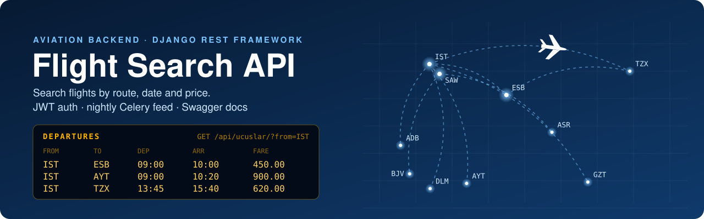
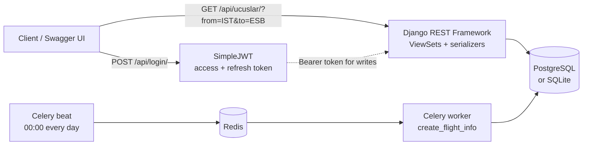
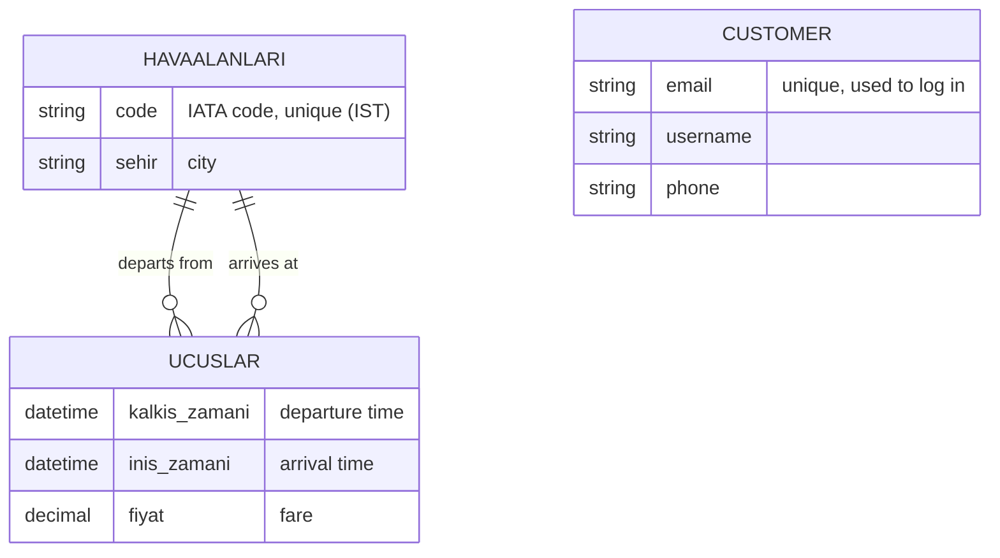

<p align="center">
  
</p>

<p align="center">
  
  
  
  
  
  
  
  
</p>

> [!NOTE]
> **Work in progress.** The API runs and its tests pass, but the project is not finished yet: English field names,
> pagination, Docker Compose and a real schedule feed are still open. See the [roadmap](#%EF%B8%8F-roadmap).

A REST API for an airline-style flight search. It stores **airports** and **flights**, lets anyone **search flights by
route, date and fare**, protects every write with **JWT**, adds new flights every night with a **Celery beat** job and
documents itself with **Swagger**. It ships with ten Turkish airports (IST, SAW, ESB, AYT, ADB, …) so it is useful
right after cloning.

## ✈️ What it does

| | |
|---|---|
| 🔎 **Flight search** | Filter by departure airport, arrival airport, departure date and maximum fare; results come sorted by departure time. |
| 🛫 **Airports and flights** | Full create / read / update / delete for both, with airports referenced by their IATA code. |
| 🛡️ **Flight rules** | A flight cannot depart and arrive at the same airport, and it must land after it takes off (also on partial updates). |
| 🔐 **JWT auth** | Register and log in with e-mail and password; searching is public, writing needs a token. |
| 🌙 **Nightly feed** | A Celery beat job (Redis broker) adds 10 new flights at midnight — a mock schedule feed, no external API. |
| 📘 **Docs and tests** | Swagger UI at `/swagger/`, ReDoc at `/redoc/`; 6 API tests and a GitHub Actions workflow. |

## 🗺️ Search in one request

```bash
curl "http://127.0.0.1:8000/api/ucuslar/?from=IST&to=ESB&date=2026-12-01&max_price=2000"
```

```json
[
  {
    "id": 1,
    "kalkis_havaalani": "IST",
    "varis_havaalani": "ESB",
    "kalkis_zamani": "2026-12-01T09:00:00",
    "inis_zamani": "2026-12-01T10:05:00",
    "fiyat": "1450.00"
  }
]
```

The evening IST → ESB flight at 2,100.00 is left out by `max_price=2000`.

| Parameter | Example | Meaning |
|---|---|---|
| `from` | `IST` | departure airport code (case-insensitive) |
| `to` | `ESB` | arrival airport code |
| `date` | `2026-12-01` | departure date, `YYYY-MM-DD` |
| `max_price` | `2000` | highest fare to show |

A malformed `date` or `max_price` returns `400` with a message, not an empty list.

## 🧭 How it fits together



## 🗂️ Data model



Field names are Turkish (the project started as a Turkish-language exercise): *havaalanı* = airport, *uçuş* = flight,
*kalkış* = departure, *varış / iniş* = arrival / landing, *fiyat* = fare, *şehir* = city.

## 🛬 Endpoints

| Method | Path | Auth | Purpose |
|---|---|---|---|
| `POST` | `/api/register/` | — | create a customer account |
| `POST` | `/api/login/` | — | e-mail + password → JWT `access` and `refresh` |
| `GET` | `/api/ucuslar/` | — | list and search flights |
| `GET` | `/api/ucuslar/{id}/` | — | one flight |
| `POST` `PUT` `PATCH` `DELETE` | `/api/ucuslar/…` | JWT | manage flights |
| `GET` | `/api/airport/?code=ay` | — | look up airports by (part of) their code |
| `POST` `PUT` `PATCH` `DELETE` | `/api/airport/…` | JWT | manage airports |
| `GET` | `/swagger/` · `/redoc/` | — | interactive API docs |

Adding a flight with a token:

```bash
TOKEN=$(curl -s -X POST http://127.0.0.1:8000/api/login/ \
  -d email=pilot@example.com -d password='Cockpit-2026!' | python -c "import sys, json; print(json.load(sys.stdin)['access'])")

curl -X POST http://127.0.0.1:8000/api/ucuslar/ -H "Authorization: Bearer $TOKEN" \
  -d kalkis_havaalani=SAW -d varis_havaalani=TZX \
  -d kalkis_zamani=2026-12-03T13:45 -d inis_zamani=2026-12-03T15:40 -d fiyat=620
```

## 🚀 Quick start

Runs on SQLite with no setup; Python 3.10+.

```bash
git clone https://github.com/YusufErem/flight-search-api.git
cd flight-search-api
python -m venv .venv && source .venv/bin/activate      # Windows: .venv\Scripts\activate
pip install -r requirements.txt

cd FlightSearchApi
python manage.py migrate
python manage.py loaddata airports                     # 10 Turkish airports
python manage.py shell -c "from flight_info.tasks import create_flight_info; create_flight_info()"   # 10 sample flights
python manage.py runserver                             # open http://127.0.0.1:8000/swagger/
```

**PostgreSQL and the nightly job.** Settings come from environment variables (listed in `.env.example`). Export
`POSTGRES_DB` and the other `POSTGRES_*` values to switch from SQLite to PostgreSQL, then start Redis and the two Celery
processes:

```bash
celery -A FlightSearchApi worker -l info
celery -A FlightSearchApi beat -l info
```

## 🧪 Tests

```bash
cd FlightSearchApi && python manage.py test flight_info -v 2
```

Six tests cover route / date / fare search, bad search parameters, the token requirement for writes, the flight rules,
airport lookup and the nightly job. The same checks are in `.github/workflows/tests.yml` (run from the Actions tab).

## 🛣️ Roadmap

- [x] Airports and flights with create / read / update / delete
- [x] Flight search by route, date and fare
- [x] JWT-protected writes and flight rules
- [x] Nightly Celery beat job (mock feed)
- [x] API tests
- [ ] Run the tests automatically on every push (GitHub Actions)
- [ ] English field names behind a versioned `/api/v2/`
- [ ] Pagination and ordering by fare
- [ ] Docker Compose for PostgreSQL, Redis and the Celery processes
- [ ] Replace the mock nightly feed with a public schedule source
